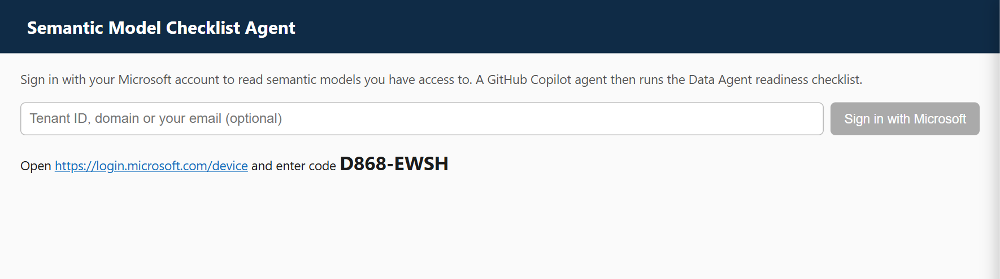
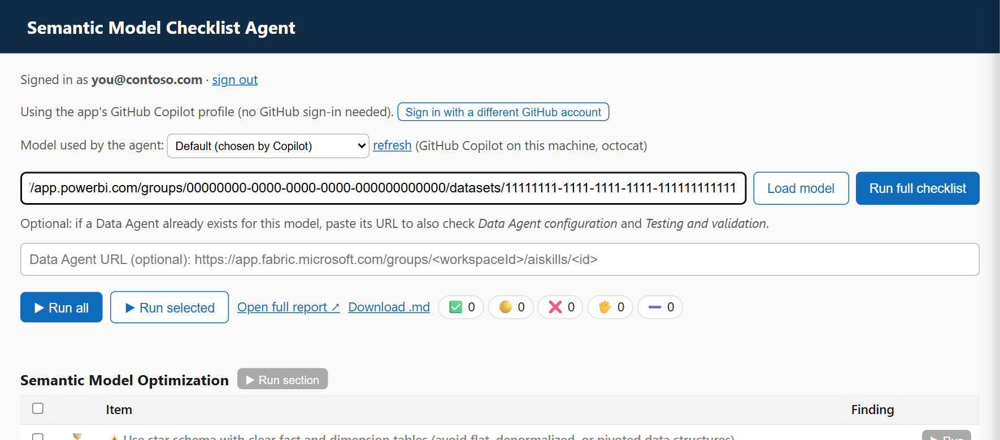
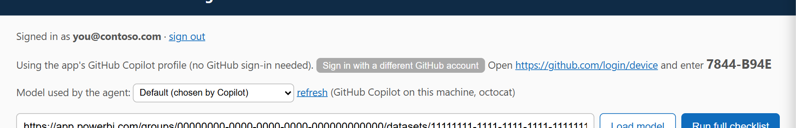
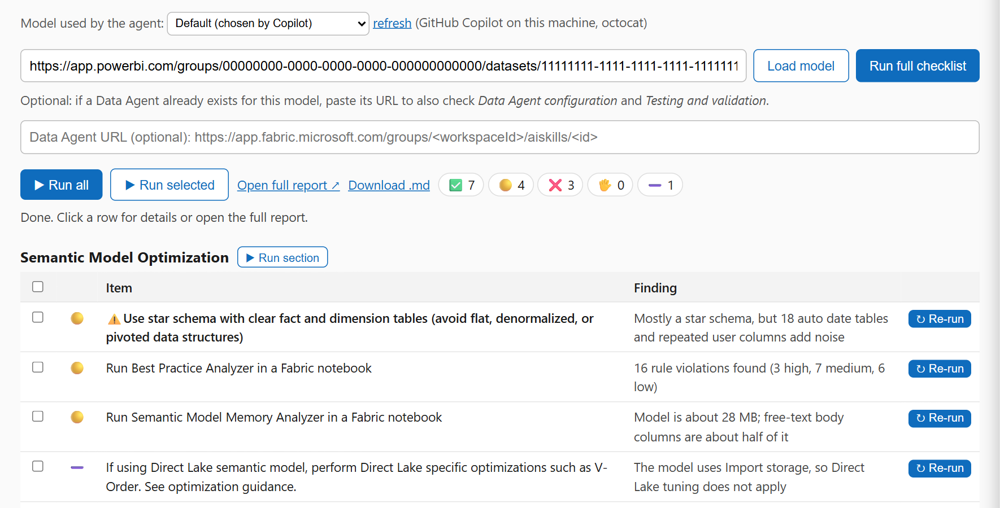
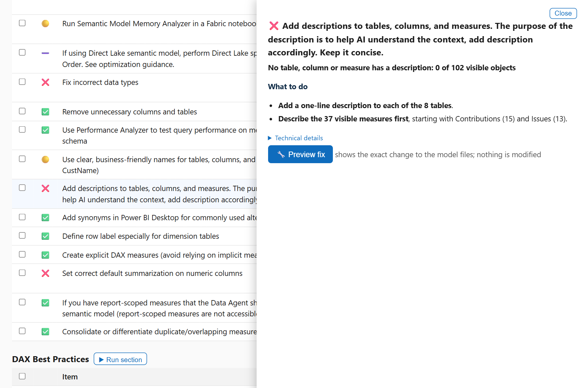
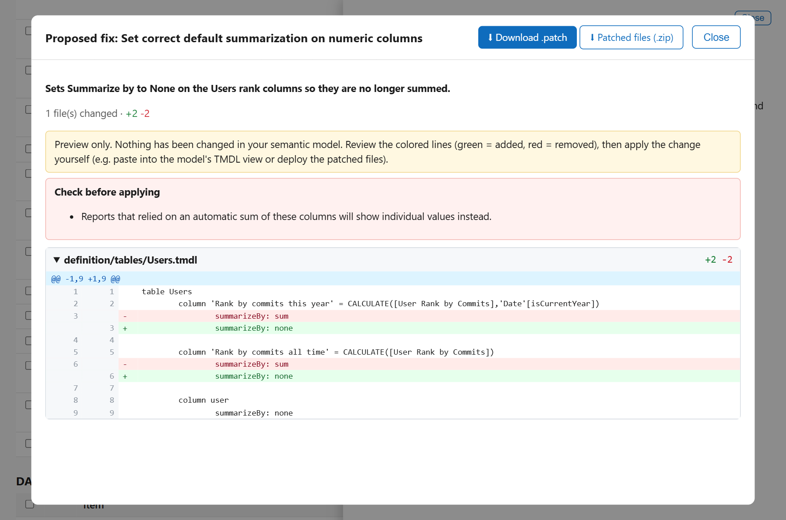
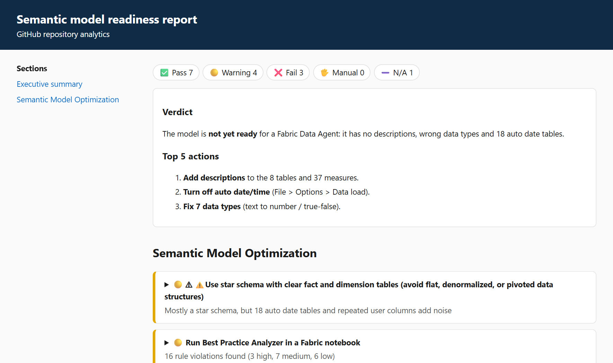

# Semantic Model Checklist Agent

Paste a Power BI / Fabric semantic model URL. A GitHub Copilot agent runs a **readiness checklist** against the live model, executes the checks itself (Best Practice Analyzer rules, memory analysis, DAX best practices, DAX it writes and runs), and gives end-user-friendly findings with **"What to do"** steps and a **diff preview** of the fix.

- Checklist = Microsoft's [Semantic Model Data Agent Checklist](https://github.com/microsoft/fabric-toolbox/blob/main/samples/data_agent_checklist_notebooks/Semantic%20Model%20Data%20Agent%20Checklist.md) (`checklist.md`) + two sections added here (`checklist-extra.md`): **DAX Best Practices** and **Question-to-DAX Validation**.
- The agent reads the model through the hosted **Power BI authoring MCP** with *your* Fabric token. It is read-only (a permission guard rejects every write).
- The two **Data Agent** sections only appear if you also paste the URL of an existing Data Agent.

## Deploy to Rayfin (Fabric App)

The app has two parts: the **web page**, deployed to Fabric with Rayfin (steps 1-4), and the **agent** that runs the checks, which can't run inside Rayfin so you start it on your computer (step 5). More: [`docs/rayfin.md`](docs/rayfin.md).

**Prerequisites:** Node 20+, Git, a Fabric workspace on a capacity where you can create items (or a capacity ID), and a GitHub Copilot plan.

**1. Clone the repo**
```bash
git clone https://github.com/aantonellims/semantic-model-checklist-agent.git
cd semantic-model-checklist-agent
npm install
```

**2. Build the Rayfin app** (the Rayfin CLI is installed locally with `npm ci`; nothing to install globally)
```bash
npm run rayfin:sync
cd rayfin-app
npm ci
npm run build
```

**3. Sign in to Fabric**
```bash
npx rayfin login
```

**4. Deploy** with `npx rayfin up` (add `-n` first for a read-only preview)
```bash
npx rayfin up -n --workspace-id <workspace-guid>
npx rayfin up --workspace-id <workspace-guid> --item-name semantic-model-checklist-agent
```
No workspace yet? Use `npx rayfin up --capacity-id <capacity-guid>` to prepare a new one on that capacity. The command prints the **hosting URL** (`https://<name>.webapp.fabricapps.net`).

**5. Start the agent on your computer.** Rayfin hosts only the web page. The agent that actually runs the checks (it needs your GitHub Copilot) cannot run inside Fabric, so you start it locally and the page talks to it. Open a terminal in the repo root (`cd ..`) and run:

```powershell
# Windows PowerShell
npx copilot login                          # once: sign in to GitHub Copilot
$env:ALLOWED_ORIGINS = 'https://<hosting-url>'   # the URL printed in step 4
npm start
```
```bash
# macOS / Linux
npx copilot login
ALLOWED_ORIGINS=https://<hosting-url> npm start
```
Keep this terminal open while you use the app. (`ALLOWED_ORIGINS` only allows your Fabric page to talk to the agent.)

**6. Open the app** from the Fabric portal (or the hosting URL), sign in to Fabric, and follow *Getting started* below.

> Want the agent hosted on a server instead of your computer? See [`docs/deployment.md`](docs/deployment.md).

Redeploy after UI changes: `npm run rayfin:sync`, then in `rayfin-app`: `npm run build` and `npx rayfin up --workspace-id <workspace-guid>`.

## Getting started (screenshots)

Once deployed, open the app and follow these steps.

> Screenshots use sample data (no customer model). Codes shown are examples; yours will differ.

### 1. Sign in with Microsoft
Click **Sign in with Microsoft** (optionally type your tenant ID, domain or email). The app shows a one-time code: open <https://login.microsoft.com/device>, enter it and sign in with the account that has access to the model. This only grants read access to your Fabric items.



### 2. Pick the model and paste the semantic model URL
By default the agent uses the app's own GitHub Copilot profile, so **no GitHub sign-in is needed**. Choose the LLM in the dropdown, paste the URL, then **Load model** or **Run full checklist**.



### 3. (Optional) Use your own GitHub account
Click **Sign in with a different GitHub account**.
- **Run on your own machine:** a browser tab opens on GitHub's own authorization page; just approve it.
- **Run on a server / Rayfin:** the app shows a short one-time code like the one below. Open <https://github.com/login/device> (GitHub's official page), type the code and approve. The code only links this app session to your GitHub account; you never type your password into this app and nothing needs to be configured in GitHub.



### 4. Read the results
Each checklist item gets a status and a one-line finding. Click a row for details.



The drawer explains the finding in plain language with **What to do** steps; technical details are collapsed.



### 5. Preview a fix
On fixable findings, **Preview fix** shows a colored diff of the change on an in-memory copy. Download it as `.patch` or ZIP. Your model is never modified.



### 6. Full report
**Open full report** gives a shareable page with a verdict and the top actions.



(Regenerate screenshots with `node scripts/screenshots.js`.)

## How it works

- `src/agent.js`: one Copilot session per checklist section with (1) the Power BI authoring MCP, (2) read-only TMDL tools, (3) the `semantic-model-review` and `powerbi-modeling` skills in `skills/`, (4) a specific prompt per item (`src/prompts.js`). Each item gets a verdict (`pass | warn | fail | manual | not_applicable`), a one-line finding, "What to do" bullets and collapsed technical details. A final session writes the executive summary.
- `src/fixes.js`: the **Preview fix** agent edits an in-memory copy of the model files; the app renders the diff, the `.patch` and the ZIP.
- `src/copilotEnv.js`, `src/githubAuth.js`, `src/auth.js`: Copilot identity and model selection, GitHub sign-in, Microsoft sign-in.
- `src/server.js` + `public/index.html`: Express API with live progress (SSE), CORS allow-list, and the single-page UI. `rayfin-app/`: the Rayfin (Fabric App) shell that hosts the UI.

## Known limitations

- **Single user per instance**: the Microsoft and GitHub sign-ins are one server-side session each, and runs live in memory. Do not share one instance between people (see `docs/deployment.md` for the multi-user path).
- Reading the definition needs **Read + Write** permission on the model; system-generated "Usage Metrics" models are not supported.
- Prep for AI settings (AI schema, verified answers, instructions) may not be exposed by the definition or MCP; those items are then reported as `manual` rather than `fail`.
- The Rayfin deployment was verified at the HTTP level (status, protected hosting, CORS); a signed-in browser check needs an interactive Fabric sign-in.
- The Docker image has not been built here.

## Run locally (optional)

Prerequisites: Node 20+, a GitHub Copilot plan (signed in with `copilot` or `gh auth login`), access to the semantic model (**Read + Write** permission is needed to read its definition).

```bash
npm install
npm start            # http://localhost:3000
```

Open http://localhost:3000 and follow the steps in *Getting started* above. Pick the agent's model in the dropdown (the list comes from your Copilot plan). Other commands: `npm test`, `node scripts/run.js "<model url>" report.md` (no UI), `node scripts/run-items.js "<model url>" i64,i09`.

More: [`docs/ux-and-fix-preview.md`](docs/ux-and-fix-preview.md) (UX and fix-preview brief), [`docs/deployment.md`](docs/deployment.md), [`docs/rayfin.md`](docs/rayfin.md).
